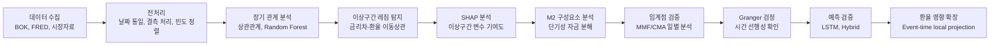
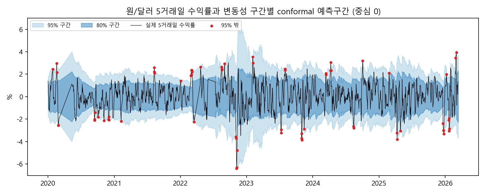
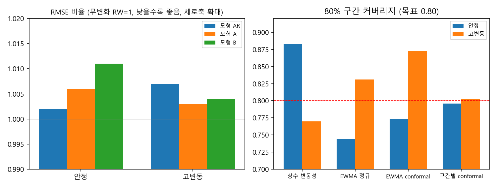
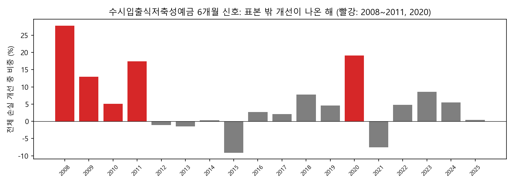

# 금리차 디커플링 구간에서 단기 유동성이 원/달러 환율 변동에 미치는 영향 분석

원/달러 환율은 한국 경제의 핵심 거시금융 변수다. 환율 상승은 수입물가, 기업 비용, 무역수지, 외국인 자금 흐름, 자산가격, 소비심리와 연결된다. 이 프로젝트는 전통적인 설명 변수인 한미 정책금리차가 환율을 충분히 설명하지 못하는 구간에서, M2 내부의 단기성 유동성이 환율 움직임을 설명하는 데 유의한 정보를 제공하는지 검증한다.

## 한눈에 보기

**결과 (3줄)**
1. "금리차 설명력이 약한 구간에서 단기 유동성이 환율을 선행하거나 더 잘 설명한다"는 가설은 Granger, 임계점, SHAP, 일별·월별 예측 어디서도 근거를 얻지 못했다. 근거 부족이며 기각은 아니다(월별 위기 구간은 검정력이 낮다).
2. 초기에 가설이 지지되는 것처럼 보인 것은 분석 오류(이상구간 정의 방향 오류, 블록 경계 처리, 월별 보간의 미래 정보, 수준값 외삽, 규모 효과) 때문이었고, 재현 가능한 코드와 테스트로 하나씩 정정했다.
3. 환율 수준은 무변화 기준선을 이기지 못하지만(walk-forward, DM 검정), 변동성 기반 예측구간(구간별 conformal)은 80%와 95%에서 안정기와 고변동기 모두 목표 커버리지를 맞춘다. 헤지 규모 조정 같은 의사결정의 입력으로 쓸 수 있다.

**한 일과 한 것이 아닌 일**

| 구분 | 내용 |
| --- | --- |
| 원 캡스톤 (2026-07까지) | 프로젝트 범위: 자료 수집, 이상구간 탐지, SHAP, 임계점, Granger, LSTM·Hybrid, 파급효과, 보고서 |
| 본인 역할 (원 캡스톤) | 기획: 연구 방향 제시 / 데이터 수집 / 관련 논문 조사와 스터디를 바탕으로 적용할 모델 제안 / 적용 모델 학습 |
| 후속 검증 (2026-11-24~) | 정의와 블록 경계 오류의 발견과 정정, 시간순 재검증과 10시드·DM 검정, 월·분기 지평 검증, walk-forward와 예측구간, 누수 테스트, 자료 확장(MMF, CMA, 교차통화). Claude Code로 진행했고 모든 커밋에 공동 저자로 표시했다. |
| 하지 않은 것 | 환율 방향 예측 모델의 고도화, 조기경보 지표 주장, 구조적 인과 주장 |

재현: `python run_all.py` (1~2분), 전체는 `python run_all.py --full`. 자료 출처와 가정은 [데이터 명세서](docs/DATA.md), 정정의 전 과정은 `analysis/limitations_check.md`, 추가 검증은 [분석 계획](docs/analysis_plan_extra.md)에 있다.

---

> **정정 안내 (후속 점검 반영)**: 이 문서의 초기 결과는 이상구간 정의가 의도와 반대 방향이었던 상태에서 나왔다. 정의를 바로잡아 다시 검정하자 M2→환율 Granger 선행성은 어떤 정의에서도 유의하지 않았고, SHAP 기여도는 모형에 따라 순위가 달라졌다. 임계점 회귀도 재실행에서 재현되지 않았다. MMF LSTM도 재실행에서 개선폭이 재현되지 않았고 정의별로 일관되지 않았다. 수시입출식 LSTM, Hybrid, 환율 영향 확장도 이후 모두 재검증했고 결론은 같았다(해당 절 참고). 아래 결과표는 이 점을 반영해 표시했다. 자세한 내용은 `analysis/limitations_check.md`에 있다.

한 문장으로 요약하면, **"금리차와 환율의 관계가 약한 구간에서 단기 유동성이 환율을 선행하거나 더 잘 설명한다"는 가설은 현재까지 통계적 근거를 얻지 못했다.** 가설이 기각된 것은 아니다. 검정력이 낮고(블록이 짧고 M2가 월별 보간값), 일부 분석은 재검증 전이므로 "근거 부족" 상태로 읽어야 한다.

> 주의: 본 연구는 M2가 환율을 구조적으로 직접 유발한다고 단정하지 않는다. Granger 인과성은 시간 선행성과 예측 정보에 대한 통계적 근거이며, SHAP은 특정 모델의 예측 기여도를 설명하는 도구다.

---

## Executive Summary

| 질문 | 결론 |
| --- | --- |
| 장기적으로 환율은 어떤 변수와 움직이는가? | 장기 구간에서는 M2, CPI, 금리차 등 거시 변수와 일정한 평균 관계가 관찰된다. 특히 금리차는 전통적 환율 설명과 부합하는 방향성을 가진다. |
| 금리차 설명력이 약해지는 구간은 어떻게 잡는가? | 환율과 한미 정책금리차의 30일 이동상관을 이용한다. 초기 정의(상관 ≤ -0.2, 668개 블록, 3,588일)는 전통적 관계(음의 상관)가 맞는 날을 뽑는 **방향 오류**가 있었다. 재정의 3종(`> -0.2`, `\|상관\| < 0.2`, `≥ +0.2`)으로 다시 검정했다(아래 정의 절 참고). |
| 이상구간에서 중요한 설명 변수는 무엇인가? | 랜덤 포레스트와 SHAP에서는 M2가 중요하게 나타났다. 그러나 테스트 구간 M2가 학습 범위를 벗어나고 모델을 바꾸면 순위가 달라져, 모형 의존성이 크다(한계 참고). |
| 왜 선형 상관은 약한데 SHAP에서는 M2가 중요한가? | RF importance가 M2에 쏠린 것은 M2가 시간 대리변수로 작동한 영향이 크다(SHAP 절 참고). 과거 가공본에서 5.11조 원과 고정기간 초과 빈도 약 2.08배가 재현됐다. 임계 효과는 부트스트랩 검정에서 유의하지 않았다(p=0.193). |
| M2가 환율보다 먼저 움직이는가? | 초기 결과(lag 2, F=25.74)는 블록 경계를 넘어 lag를 만든 결과였다. lag를 블록 안에서만 만들고 이상구간을 3가지로 재정의해도 M2→환율은 모든 lag에서 유의하지 않았다(p=0.25~0.96). 선행성 근거를 찾지 못했다. |
| 예측 모델에서도 개선되는가? | 초기 결과에서는 이상구간에서 유동성 추가 모델이 금리차 단독 모델보다 낮은 오차를 보였다(전체 구간에서는 아님). MMF LSTM 재실행(시드 42)에서는 개선폭이 재현되지 않았고(4.54 → 0.27), 재정의 3종에서도 일관되지 않았다(B +0.24, A -6.22, C -2.34). naive baseline을 이기지 못한 점도 유의해야 한다. 이후 학습 설정 오류(수준값 예측)를 바로잡아 시간순 평가에서 LSTM 10시드와 Hybrid 10시드로 다시 비교했을 때도 유동성 추가 모델은 기본 모델을 유의하게 이기지 못했다(아래 정상화 설정 절). |
| 환율 충격은 어디로 파급되는가? | 확장 분석에서는 event-time local projection으로 환율 충격 이후 소비자심리지수, 수입액, 외국인 투자, 무역수지 등 8개 변수의 1-6개월 반응을 추정했다. 다중 검정 보정(Holm) 후에도 일부 계수만 남았고 충격 식별은 하지 않아 인과효과로 읽으면 안 된다. |

---

## 연구 질문

이 연구는 단순히 "최근 환율이 왜 올랐는가"를 묻지 않는다. 더 좁고 검증 가능한 질문으로 바꾸었다.

1. 장기적으로 원/달러 환율과 주요 거시 변수는 어떤 평균 관계를 보이는가?
2. 한미 정책금리차와 환율의 관계가 약해지는 이상구간 레짐은 어떻게 정의할 수 있는가?
3. 이상구간 레짐에서는 금리차보다 단기 유동성 변수가 환율 움직임을 더 잘 설명하는가?
4. 단기 유동성의 영향은 선형적인가, 아니면 특정 수준 이후 커지는 임계점 구조인가?
5. M2 변화는 환율 변화를 시간적으로 선행하는가?
6. 단기 유동성 변수를 추가한 예측 모델은 이상구간에서 금리차 단독 모델보다 개선되는가?
7. 환율 충격은 이후 국내 거시, 금융 변수로 어떻게 전달되는가?

---

## 분석 흐름



---

## 데이터와 분석 단위

| 구분 | 변수 | 빈도 | 역할 |
| --- | --- | --- | --- |
| 목표 변수 | USD/KRW 환율 | 일별, 월별 | 분석 대상, 예측 대상, 이상구간 탐지 기준 |
| 금리 변수 | 한국 기준금리, 미국 정책금리, 한미 정책금리차 | 일별, 월별 | 전통적 환율 설명 변수 |
| 통화량 | 한국 M2, 미국 M2 | 월별, 필요 시 일별 정렬 | 장기 요인, 이상구간 선행성 분석 |
| M2 구성요소 | 수시입출식저축성예금, 요구불예금, MMF, 현금통화 등 | 월별 | 단기성 자금 증가 여부 분석 |
| 단기 유동성 | MMF, CMA 보조 지표 | 일별 | 임계점 회귀, SHAP 의존도 분석 |
| 확장 변수 | CPI, 산업생산, KOSPI, 무역수지, 외국인 주식/채권 투자, CSI/BSI 등 | 월별 | 환율 충격의 거시, 금융 파급효과 분석 |

주요 데이터셋:

- `data/processed_daily_1995_2026_integrated.csv`: 장기 일별 통합 데이터
- `analysis/anomaly/anomaly_concatenated_dataset.csv`: 이상구간 레짐 결합 데이터
- `analysis/LSTM/lstm_mmf/daily_dataset.csv`: MMF 기반 일별 LSTM 데이터
- `analysis/LSTM/lstm_m2_demand_deposit/daily_dataset_m2_demand_deposit.csv`: 수시입출식저축성예금 기반 일별 LSTM 데이터
- `data/integrated_macro_targets.csv`: 환율 영향 확장 분석용 월별 거시, 금융 통합 데이터

---

## 이상구간 레짐 정의

초기 분석은 2024년 11월 이후의 최근 고환율 기간을 고정된 이상기간으로 보았다. 그러나 이 방식은 시작일과 종료일 선택의 자의성이 있다. 최종 분석에서는 특정 사건을 임의로 자르기보다, **한미 정책금리차와 원/달러 환율의 관계가 실제로 약해지는 시장 상태**를 데이터 기반으로 추출했다.

사용한 핵심 기준은 다음과 같다.

- 환율과 한미 정책금리차의 30일 이동상관관계 계산
- 이동상관관계가 설정 기준 이하로 약화되는 관측치를 이상구간 후보로 분류
- 최종 분석 데이터 범위: 1995-01-01 ~ 2026-03-20
- 최종 이상구간 결합 자료: 668개 블록, 3,588개 관측일


> 위 그림은 정의 오류 전 초기 설정으로 그린 것이다(참고용). 최종 그림은 `analysis/figures/`에 있다.

이상구간 레짐은 하나의 긴 사건이 아니다. 외환위기, 금융위기, 팬데믹, 글로벌 긴축기처럼 금리차-환율 관계가 반복적으로 약화되는 여러 시장 상태를 하나의 분석 레짐으로 묶으려는 의도였다.

### 정의 오류와 재정의 (후속 점검)

위 정의는 코드에서 `rolling_corr <= -0.2`로 구현되어 있다. 스프레드는 `한국 - 미국`이라 금리차가 커지면 원화 강세(환율 하락)가 되는 전통적 관계는 **음(-)** 이다. 따라서 `<= -0.2`는 디커플링이 아니라 **전통적 관계가 맞는 날**을 뽑는다.

- 연구 동기가 된 2024-11 ~ 2025-12에서 30일 이동상관은 `<= -0.2`가 15%, `|상관| < 0.2`가 53%, `>= +0.2`가 33%였다.
- 초기 이상구간 3,588일 중 이 기간은 3.5%뿐이다.
- 커밋된 정의 파일(3,588일, 668블록)은 현재 코드와 데이터로 재현되지 않는다(재현 시 3,350일, 495블록).
- 668개 블록은 중앙값 길이가 1일이고 30일 이상은 20개뿐이다. 설정값 `min_contiguous_days: 30`은 시작 구간을 고르는 데만 쓰였다.
- 30일 이동상관은 전체 표본에서 중앙값이 0이고 음, 무관, 양이 약 3분의 1씩이다. 이 지표 하나로 레짐을 정의하는 방식 자체가 약하다.

재정의 3종은 A(`> -0.2`, 7,194일), B(`|상관| < 0.2`, 3,723일), C(`>= +0.2`, 3,471일)이며, 코드는 `analysis/anomaly/rerun_redefined.py`, 결과는 `analysis/anomaly/results_redefined/`에 있다. 이후 결과 절의 수치 중 "초기 정의 기준"이라고 표시한 것은 방향이 잘못된 구간에서 나온 값이다.

---

## 주요 결과 1. 장기 관계와 이상구간의 괴리

장기 구간에서는 환율과 주요 거시 변수 사이에 평균적인 관계가 관찰된다.

- M2와 CPI는 환율과 양의 관계를 보인다.
- 한미 정책금리차는 환율과 음의 관계를 보이며, 전통적 설명과 대체로 부합한다.
- 그러나 이상구간 레짐에서는 이 평균 관계가 충분하지 않다.

핵심은 **장기 평균 관계와 이상구간 조건부 관계를 분리해야 한다**는 점이다. 정상구간까지 포함한 전체 표본에서는 금리차나 환율 자체의 관성이 강하게 작동한다. 금리차 설명력이 약해지는 구간에서 단기 유동성 변수가 추가 정보를 제공한다는 주장은 초기 정의에서의 관찰이었고, 정의를 바로잡은 뒤에는 뒷받침되지 않았다.

---

## 주요 결과 2. SHAP 분석과 M2 구성요소

이상구간에서 랜덤 포레스트와 SHAP 분석을 수행했다. 이상구간 SHAP 분석에 사용된 관측치는 3,588개이며, 같은 구조의 baseline 분석에는 7,814개 관측치가 사용되었다.

`analysis/shap_ml/results_anomaly/importance_summary.csv` 기준 이상구간 랜덤 포레스트 중요도는 다음과 같다.

| 변수 | RF importance | mean abs SHAP |
| --- | ---: | ---: |
| `M2_KOR` | 0.963 | 18.411 |
| `policy_spread` | 0.027 | 27.568 |
| `M2_USA` | 0.010 | 11.868 |

해석상 중요한 점은 두 가지다.

1. M2는 이 RF 모형에서 강한 설명 변수로 사용되었다. 그러나 평균 |SHAP|은 `policy_spread`(27.6)가 `M2_KOR`(18.4)보다 크다. RF importance만 M2에 쏠려 있다.
2. SHAP은 인과관계가 아니라 모델 기여도다. 따라서 이후 임계점 회귀와 Granger 검정으로 비선형성과 시간 선행성을 별도로 확인했다.
3. 후속 점검(`analysis/shap_ml/compare_models.py`)에서 이 결과의 신뢰도가 낮음을 확인했다. 시간순 80/20 분할의 테스트 구간 M2가 학습 범위를 100% 벗어나 RF, XGBoost, Ridge의 테스트 R²가 모두 음수(-0.9 ~ -2.0)였고, 모델에 따라 M2_KOR의 SHAP 순위가 1~3위로 바뀌었다. 21일 변화율로 바꾸면 세 모델 모두 `policy_spread` 1위, `M2_KOR` 2위였지만 R²가 0 이하였다. RF importance 0.963은 M2가 시간 대리변수로 작동한 결과일 가능성이 크다.
4. 이상구간을 재정의한 3종(A, B, C)에서 같은 비교를 다시 했을 때도 대부분 테스트 R²가 음수였고 M2_KOR 순위가 모델마다 달랐다. 정의 B의 RF 수준값 한 건(R² 0.39)만 양수였으나 XGBoost와 Ridge는 음수여서 견고하지 않았다. 따라서 이 표의 "M2가 가장 중요"라는 읽기는 근거가 약하다.


> 위 그림은 정의 오류 전 초기 설정으로 그린 것이다(참고용). 최종 그림은 `analysis/figures/`에 있다.

M2 총량만으로는 어떤 자금이 환율 불안과 관련되는지 알기 어렵다. 그래서 M2 내부 구성요소를 분해했다. 분석 결과는 수시입출식저축성예금, 요구불예금, MMF 등 빠르게 이동 가능한 단기성 자금에 주목해야 함을 보여준다.


---

## 주요 결과 3. 단기 유동성 임계점 가설

선형 상관관계에서는 이상구간의 M2-환율 관계가 약하게 보일 수 있다. 그러나 SHAP에서는 M2와 단기성 자금이 중요하게 나타난다. 이 차이를 설명하기 위해 **임계점 가설**을 세웠다.

가설은 다음과 같다.

> 단기 유동성이 조금씩 증가할 때마다 환율이 같은 비율로 상승하는 것이 아니라, 특정 수준을 넘는 순간 환율 반응이 급격히 커질 수 있다.

일별 단기 유동성 데이터로 threshold regression을 수행한 결과, 기존 결과 문서 기준으로 일일 유동성이 약 5.1조 원 이상 증가하는 구간에서 환율 반응이 비선형적으로 커지는 패턴이 관찰되었다. 또한 이 임계값을 넘는 날은 이상기간에 더 자주 나타났다.

> 정정: 이 절의 임계점 분석은 이상구간 레짐 정의를 쓰지 않는다. 전체 표본에서 임계값을 찾고, 고정기간(2024-11 ~ 2025-12)의 초과 빈도만 센 것이다. 현재 체크아웃의 데이터에서는 5.1조 원과 약 2배의 빈도가 재현되지 않았으며, Git 기록의 과거 가공본에서는 두 수치가 재현됐다.
>
> 재실행(`analysis/daily_threshold_MMF/rerun_redefined.py`): 원본 환율 파일이 현재 체크아웃에 없고 `M2_proxy` 컬럼도 현재 CSV에 없어, CMA+MMF 프록시를 원래 방식으로 다시 만들었다. 이 프록시는 2015-12-02 ~ 2026-03-16(2,531일)만 덮어 "과거 15년"이 아니다. 같은 TAR 탐색의 임계값은 **6.57조 원**이었고, 부트스트랩 sup-F 검정(B=300)은 F=3.65, **p=0.199**로 임계 효과가 유의하지 않았다(기존 분석에는 이 검정이 없었다). 부트스트랩을 B=2000으로 늘려도 같은 임계값 6.57조 원에서 **p=0.187**로 결론이 같았다.
>
> 임계값 초과 빈도는 이상구간 안과 밖이 거의 같았다. 고정기간 3.16% 대 3.07%(비율 1.03, Fisher p=0.86), 초기 정의 3.00% 대 3.12%, 재정의 A 3.31% 대 2.48%(p=0.30), B 3.43% 대 2.76%(p=0.36), C 3.07% 대 3.09%. "이상기간에 약 2배"는 어떤 정의에서도 나오지 않았다. 데이터 기간이 원래 분석과 다를 수 있어 원 분석이 틀렸다고 단정할 수는 없으나, 현재 저장소의 데이터로는 임계점 가설을 뒷받침하지 못한다.


> 위 그림은 정의 오류 전 초기 설정으로 그린 것이다(참고용). 최종 그림은 `analysis/figures/`에 있다.

MMF와 CMA를 나누어 SHAP dependence를 확인하면 MMF에서 임계점 이후 기여도가 더 뚜렷하게 나타난다. CMA는 같은 패턴이 상대적으로 명확하지 않았다.


> 위 그림은 정의 오류 전 초기 설정으로 그린 것이다(참고용). 최종 그림은 `analysis/figures/`에 있다.


> 위 그림은 정의 오류 전 초기 설정으로 그린 것이다(참고용). 최종 그림은 `analysis/figures/`에 있다.

---

### 과거 가공본 재현

Git 커밋 `8ec5ccb`의 가공본을 사용하면 변화량 표본 3,704건에서 임계값 **5.11조 원**과 고정기간 초과 빈도 **6.82% 대 3.28%**가 재현된다. 비교 대상은 고정기간 밖이며, 해당 가공본의 마지막 관측일은 2025-12-01이다. 부트스트랩 sup-F 검정은 p=0.193이었다. 후속 커밋 `e381d3c`의 가공본에서는 6.57조 원과 p=0.199가 나왔다. 두 표본 모두 5% 수준에서 유의한 임계 효과를 확인하지 못했다.

### 일별 MMF 2006년 이후 확장

금융투자협회 통계 포털에서 받은 일별 MMF(2006-04~)로 임계점 회귀를 확장했다(`python analysis/run_threshold_mmf_extended.py 1000`, 규모 효과를 제거한 사양은 `... 1000 pct`). CMA 일별 자료는 2015-12 이후만 있어 CMA 없이 MMF 단독 변화량을 쓴다. 같은 TAR 탐색과 부트스트랩 sup-F(B=1000)를 썼다.

| 표본 | 사양 | 임계값 | sup-F | 부트스트랩 p |
| --- | --- | ---: | ---: | ---: |
| 2015-12~ (2,536일) | 절대 변화량 | 4.98조 원 | 6.03 | **0.041** |
| 2006-04~ (4,941일) | 절대 변화량 | 3.31조 원 | 5.46 | 0.102 |
| 2006-04~2015-11 (2,405일) | 절대 변화량 | 2.45조 원 | 5.61 | 0.242 |
| 2015-12~ | 로그 변화율 | 0.34% | 4.21 | 0.133 |
| 2006-04~ | 로그 변화율 | 2.10% | 3.63 | 0.396 |
| 2006-04~2015-11 | 로그 변화율 | 2.14% | 7.43 | 0.091 |

- 2015-12 이후 MMF 단독 표본에서 임계값이 4.98조 원(초기 5.1조 원과 비슷)이고 p=0.041로 5% 수준에서 유의했다. 이 표본의 CMA+MMF 프록시 결과(p=0.19)와 다르다. 그러나 2006년부터 늘리면 p=0.10, 이전 구간만 보면 p=0.24로 사라진다. 임계값도 4.98, 3.31, 2.45조 원으로 표본마다 크게 달라 안정적인 값이 아니다.
- 절대 변화량의 임계값은 규모 효과를 받는다. MMF 잔액이 2006년 약 70조 원에서 2026년 약 280조 원으로 커져 같은 절대 기준은 최근 기간에 기계적으로 더 자주 넘어간다. 2006년 이후 절대 사양에서 고정기간(2024-11~2025-12)의 초과 빈도는 11.6% 대 4.6%(비율 2.5, Fisher p<0.001)로 "이상기간에 약 2배"가 다시 나타나지만, 로그 변화율로 규모를 제거하면 6.7% 대 9.1%(비율 0.73, p=0.20)로 사라진다. 따라서 초기 결과의 "이상기간 약 2배"는 MMF 규모 증가를 반영했을 가능성이 크다.
- 로그 변화율 사양에서는 세 표본 모두 임계 효과가 유의하지 않았다(p=0.09~0.40). 이상구간 정의 A, B, C와 사전지정 위기 구간에서 안과 밖의 초과 빈도 차이도 대부분 유의하지 않았고(비율 0.9~1.2), 명목 p<0.05가 한 건(정의 C, 2006-04~ 로그 사양, p=0.032) 있으나 여러 비교 중 하나라 보정하면 남지 않는다.
- sup-F 검정 6개 중 명목 유의는 1건(p=0.041)이고, 6개를 Holm 보정하면 최소 보정 p는 0.25다. 절대 사양의 2015-12~ 결과는 표본 선택과 규모 효과에 민감한 한 건의 결과로 본다.
- 한계: MMF 단독이라 초기 분석의 CMA+MMF와 다르다. 이 한계는 아래에서 CMA를 추가해 보완했다. 결과는 [검정 CSV](analysis/results_power_regimes/threshold_mmf_extended.csv), [초과 빈도 CSV](analysis/results_power_regimes/threshold_mmf_breach.csv)와 `_pct` 버전에 있다.

**CMA 일별 자료 추가와 초기 프록시(CMA+MMF) 재현**: 금융투자협회 통계 포털의 "운용대상별 CMA잔고 추이"에서 일별 CMA 잔고를 받았다(`data/m2/KOR/CMA/CMA_balance_2006_2026.csv`, 억원 단위이며 10으로 나눠 기존 십억원 자료와 겹치는 2,532일의 상대 오차가 0.003% 이내(구성항목 반올림 차이)). 일별 값은 2009-01부터이고 2006~2008년은 월말 또는 드문 관측이라 2009-01 이후만 쓴다(`python analysis/run_threshold_mmf_extended.py 1000 proxy`, 규모 제거는 `... 1000 proxy pct`).

| 표본 | 사양 | 임계값 | 부트스트랩 p |
| --- | --- | ---: | ---: |
| 2015-12~ (2,536일) | 절대 변화량 | 6.57조 원 | 0.166 |
| 2009-01~ (4,260일) | 절대 변화량 | 5.34조 원 | 0.199 |
| 2009-01~2015-11 (1,724일) | 절대 변화량 | 0.63조 원 | 0.918 |
| 2015-12~ | 로그 변화율 | 1.98% | 0.370 |
| 2009-01~ | 로그 변화율 | 2.71% | 0.263 |
| 2009-01~2015-11 | 로그 변화율 | 1.31% | 0.983 |

- 2015-12 이후에서 기존 재검증과 같은 값(임계값 6.57조 원, p=0.17~0.20)이 재현되어, 초기 프록시를 원 방식으로 다시 만든 것이 맞다는 점을 확인했다.
- 2009년까지 늘려도, 규모를 제거해도 임계 효과는 유의하지 않았다(p=0.17~0.98). MMF 단독에서 나온 p=0.041은 CMA를 더하면 사라지므로 MMF 단독 표본에 한정된 결과다.
- 절대 변화량에서 고정기간 초과 빈도는 2009-01 이후 5.6% 대 2.8%(약 2배, p=0.018)로 다시 나타나지만 로그 변화율로 규모를 제거하면 2.5% 대 3.6%(0.68배, p=0.41)로 사라진다. 초기 "이상기간 약 2배"는 CMA와 MMF 잔액 증가의 규모 효과로 설명된다.
- 정의 C의 초과 빈도 비교(2015-12~, 로그 변화율, 10.7% 대 6.1%, p<0.001) 등 명목 유의 비교가 일부 있으나, 비교가 수십 건이고 방향이 일관되지 않아(같은 표본의 위기 구간은 0.62배) 보정하면 근거가 되지 못한다.

## 주요 결과 4. Granger 인과성 검정

Granger 인과성 검정은 단기 유동성이 환율보다 먼저 움직이는지 확인하기 위한 시계열 검정이다. 구조적 인과를 증명하지는 않지만, 한 변수의 과거값이 다른 변수의 미래 변화를 예측하는 데 유의한 정보를 제공하는지 검정한다.

검정은 이상구간과 정상구간을 나누어 수행했다. 특히 이상구간 결합 자료에서는 서로 떨어진 블록 사이의 가짜 점프를 줄이기 위해 구간 내부 변화율을 기준으로 해석한다.

| 구간 | 방향 | Lag | F-stat | p-value | 해석 |
| --- | --- | ---: | ---: | ---: | --- |
| 이상구간 | FX -> M2 | 2 | 0.1223 | 0.8849 | 유의하지 않음 |
| 이상구간 | M2 -> FX | 2 | 25.7423 | 8.28e-12 | 유의함 |
| 정상구간 | FX -> M2 | 2 | 0.0321 | 0.9685 | 유의하지 않음 |
| 정상구간 | M2 -> FX | 2 | 1.8359 | 0.1723 | 유의하지 않음 |

위 표는 변화율만 블록 안에서 계산하고, lag 회귀변수는 이어 붙인 행에서 만든 기존 방식의 결과다. 이 방식에서는 서로 다른 블록의 값이 lag로 섞인다. 이상구간 668개 블록은 중앙값 길이가 1일이고 30일 이상인 블록이 20개뿐이어서 이 영향이 크다.

`analysis/m2_components/granger_block_safe.py`로 t, t-1, ..., t-p가 모두 같은 블록 안인 행만 사용해 다시 검정했다. 같은 코드로 기존 방식을 돌리면 위 표(lag 2에서 F=25.74)가 그대로 재현된다.

| 방향 | Lag | 기존 F | 블록 안만 사용 F | p-value |
| --- | ---: | ---: | ---: | ---: |
| M2 -> FX | 1 | 12.43 | 4.34 | 0.037 |
| M2 -> FX | 2 | 25.74 | 2.18 | 0.113 |
| M2 -> FX | 3 | 19.73 | 1.42 | 0.234 |
| FX -> M2 | 1-3 | - | 0.00 - 1.00 | 0.37 - 0.98 |

결론은 수정한다. **블록 경계를 넘지 않게 처리하면 M2 -> FX 선행성은 lag 2, 3에서 유의하지 않고 lag 1에서만 약하게 나타난다.** 따라서 이 연구는 M2의 선행성을 확정 결과로 주장하지 않는다. 또한 M2는 월별 값을 선형보간한 일별 계열이어서, 일별 선행성으로 해석하는 데 한계가 있다. 월별 자료 기준 재검정 결과는 아래에 정리했다.

이상구간 정의 방향 오류까지 바로잡은 재검정(`analysis/anomaly/rerun_redefined.py`) 결과는 다음과 같다. 값은 M2 -> FX의 p-value이며, 블록 안에서만 lag를 만들었다.

| 이상구간 정의 | 블록 최소 길이 | lag 1 | lag 2 | lag 3 |
| --- | ---: | ---: | ---: | ---: |
| A: 상관 > -0.2 | 1 | 0.71 | 0.96 | 0.93 |
| A | 30 | 0.74 | 0.92 | 0.88 |
| B: \|상관\| < 0.2 | 1 | 0.95 | 0.92 | 0.88 |
| B | 30 | 0.30 | 0.25 | 0.37 |
| C: 상관 >= +0.2 | 1 | 0.83 | 0.95 | 0.96 |
| C | 30 | 0.82 | 0.87 | 0.90 |

모든 정의와 lag에서 M2 -> FX는 유의하지 않았다. 따라서 위 첫 번째 표의 "이상구간에서만 M2가 환율을 선행한다"는 결론은 이 README의 결론으로 쓰지 않는다. 다만 정의 B에서 30일 이상 블록은 18개뿐이라 검정력이 낮고, M2가 월별 값을 보간한 계열이라 일별 Granger 자체가 약한 검정이다. "선행성이 없다"가 아니라 "근거를 찾지 못했다"로 읽어야 한다.

---

### 월별 자료 재검정

월별 M2와 월평균 원/달러 환율의 로그 변화율을 사용해 전체 월별 표본에서 Granger 검정을 다시 했다. M2의 추가 지연을 0·1·2개월로 설정하고 각각 시차 1~3개월을 비교했다. M2→환율의 최저 p값은 0.122였고, 5% 수준에서 유의한 조합은 없었다. 추가 지연은 발표일을 직접 추적한 값이 아닌 민감도 분석용 가정이다. 결과는 [월별 검정 CSV](analysis/results_time_ordered/monthly_granger.csv)에 있다.

### 검정력과 외부 기준 레짐 검정

"근거를 찾지 못했다"가 "효과가 없다"인지 가리기 위해 최소 탐지 효과(MDE)를 시뮬레이션했고(`python analysis/run_power_and_event_regimes.py`), 이동상관이 아닌 외부 기준으로 레짐을 다시 정의해 유동성 -> 환율 Granger 검정을 반복했다. 외부 기준은 두 가지다. 하나는 사전에 정한 위기 구간 8개(1997 외환위기, 2008 금융위기, 2011 유럽 재정위기, 2013 테이퍼 탠트럼, 2015 위안화 쇼크, 2020 팬데믹, 2022 연준 긴축, 2024-11~2025-12)이고, 날짜는 일반적으로 알려진 시기를 월 단위로 반올림한 근사값이며 결과를 본 뒤 바꾸지 않았다. 다른 하나는 VIX가 30 이상인 달이다. lag는 같은 구간 안에서만 만들었다.

효과 크기는 "x가 1 표준편차 변할 때 y가 y의 표준편차의 b배 변하는 정도"이며, 표의 MDE는 검정력 80%에 처음 도달하는 b다(y의 lag 회귀변수를 실제값으로 고정한 조건부 검정력).

| 표본 | lag 1 표본 수 | MDE (lag 1 / lag 3) |
| --- | ---: | ---: |
| 월별 M2, 전체 | 371 | 0.15 / 0.15 |
| 월별 M2, 사전지정 위기 구간 | 47 | 0.50 / 0.5 도달 못함 |
| 월별 M2, VIX >= 30 | 16 | 0.5 도달 못함 |
| 일별 MMF, 전체(기존 자료, 2010-12~) | 3,768 | 0.05 / 0.10 |
| 일별 MMF, 전체(2006-04~, freesis 장기 자료) | 4,940 | 0.05 / 0.05 |
| 일별 MMF(2006-04~), 사전지정 위기 구간 | 957 | 0.10 / 0.15 |
| 일별 MMF(2006-04~), 2008 금융위기 | 145 | 0.30 / 0.30 |
| 일별 MMF(2006-04~), 2015 이전 위기 구간 | 307 | 0.20 / 0.20 |
| 일별 MMF, 2024-11~2025-12 | 284 | 0.20 / 0.20 |

- 월별 자료는 위기 구간으로 좁히면 표본이 47건, VIX 구간은 16건뿐이라 효과를 검정할 수 없다. 이 표본에서의 "유의하지 않음"은 정보가 없다는 뜻이다.
- 일별 MMF 전체 표본은 작은 효과(b 0.05~0.10)까지 탐지할 수 있다. 기존 자료 표본(2010-12 이후, p=0.53~0.72)과 금융투자협회 통계 포털에서 새로 받은 2006-04 이후 표본(p=0.05~0.20, lag 3의 p=0.053이 가장 작고 5%를 넘는다) 모두에서 MMF -> 환율이 유의하지 않았다. 따라서 1~3일 지평에서는 그보다 큰 효과가 있다는 근거가 없다고 말할 수 있다. 새 자료의 단위는 억원이라 10으로 나눠 기존 십억원 자료와 맞췄고, 겹치는 3,773일이 모두 일치했다.
- 2008 금융위기 구간(145건)에서도 유의하지 않았으나(p=0.19~0.28) 최소 탐지 효과가 b=0.30이라 작은 효과는 가려낼 수 없다.
- 사전지정 위기 구간의 월별 M2 -> 환율에서 명목 p<0.05가 2건 나왔다(M2를 한 달 늦춘 lag 1 p=0.005, lag 3 p=0.007). 그러나 같은 표본의 lag 2는 p=0.71, 늦추지 않은 사양에서는 모두 유의하지 않았고, 일별 MMF 검정을 포함한 유동성 -> 환율 검정 38개를 하나의 군으로 Holm 보정하면 최소 보정 p가 0.20이어서 하나도 남지 않았다. 표본이 31~47건이라 우연으로 보아야 한다.

결과는 [검정력 CSV](analysis/results_power_regimes/power_mde.csv), [검정 CSV](analysis/results_power_regimes/regime_granger.csv)에 있다.

**표본 부족과 날짜 근사값 보완** (`python analysis/run_regime_interaction.py`): 구간별로 쪼개 표본 31~47개로 검정하는 대신, 전체 월별 표본(약 370개월)에서 위기 구간 더미와 유동성 lag의 상호작용(위기 구간에서 유동성 효과가 달라지는가)을 HC3 Wald로 검정했다. 자기회귀 계수를 전체 표본이 공유하므로 구간 분할보다 정보를 더 쓴다. 위기 구간 날짜의 근사값 문제는 시작과 끝을 +-1, +-2개월 옮긴 9개 변형과 VIX >= 30 더미로 민감도를 확인했다.

- 어떤 변형, 지연, lag에서도 상호작용은 유의하지 않았다(p=0.39~0.998, 최솟값 0.059가 한 건). 앞 절의 구간별 검정에서 나온 명목 유의 2건은 전체 표본에서 공유 계수로 검정하면 사라졌다.
- 결론은 위기 구간 날짜를 +-2개월 바꿔도 달라지지 않았다. 날짜의 근사값이 결과를 좌우하지는 않는다.
- 다만 이 검정도 검정력이 낮다. 위기 구간 더미(55개월)의 상호작용은 효과 b=0.5에서도 검정력이 lag 1에서 0.59, lag 3에서 0.35에 그쳤고, VIX 더미(32개월)는 각각 0.73, 0.53이었다. 월별 자료로는 위기 구간의 큰 효과(y 표준편차의 절반 이상)가 아니면 탐지할 수 없다.
- 월별 M2는 위기 구간 안 표본을 늘릴 방법이 없다. 일별 MMF는 금융투자협회 통계 포털에서 2006-04부터 받아 2008 금융위기까지 검정했지만, 1997 외환위기 구간은 여전히 일별 유동성 자료가 없어 검정할 수 없다. 월별 위기 구간의 표본 부족은 자료 빈도 문제라 남는다.

---

## 주요 결과 5. 예측 모델 검증

예측 모델의 목적은 모든 기간에서 환율을 가장 잘 맞히는 절대 최적 모델을 만드는 것이 아니다. 핵심은 **금리차 단독 모델과 단기 유동성 추가 모델을 비교했을 때 이상구간에서 설명력이 개선되는지** 확인하는 것이다.

모델 정의:

- Model A: `USD_KRW + RATE_SPREAD_KOR_USA`
- Model B: `USD_KRW + RATE_SPREAD_KOR_USA + 단기 유동성 변수`
- 예측 구조: 과거 30일 입력, 5영업일 ahead 예측
- 주요 평가 지표: RMSE, MAE

### MMF 기반 LSTM

| 평가 구간 | Model A RMSE | Model B RMSE | 결과 |
| --- | ---: | ---: | --- |
| 전체 구간 2010-2026 | 43.98 | 44.48 | 금리차 단독 근소 우위 |
| 고정 이상구간 2024-11 ~ 2026-03 | 21.06 | 18.77 | MMF 추가 모델 우위 |
| 이상구간 레짐 extended | 21.16 | 16.62 | MMF 추가 모델 우위 |

### 수시입출식저축성예금 기반 LSTM

| 평가 구간 | Model A RMSE | Model B RMSE | 결과 |
| --- | ---: | ---: | --- |
| 전체 구간 2010-12 ~ 2026-03 | 44.62 | 64.00 | 금리차 단독 우위 |
| 고정 이상구간 2024-11 ~ 2026-03 | 21.21 | 18.98 | 유동성 추가 모델 우위 |
| 이상구간 레짐 extended | 15.07 | 14.89 | 유동성 추가 모델 근소 우위 |

위 표의 이상구간 레짐 extended 행은 초기 정의(방향 오류 구간)에서 나온 값이다. 고정 이상구간(2024-11 ~ 2026-03) 행은 레짐 정의와 무관하게 계산되었으나 시드 반복이나 유의성 검정이 없다.

### MMF LSTM 재실행 (후속 점검)

`analysis/LSTM/rerun_redefined.py`로 MMF 기반 LSTM을 이상구간 정의별로 다시 돌렸다(시드 42 하나, 기존 `train_eval_extended.py`의 학습·평가 코드를 그대로 사용). 결과는 `analysis/LSTM/results_redefined/lstm_summary_all.csv`에 있다. RMSE 기준이며, 개선폭은 금리차 단독 모델 RMSE에서 유동성 추가 모델 RMSE를 뺀 값이다.

| 이상구간 정의 | 평가 블록 | 금리차 단독 | 유동성 추가 | 개선폭 |
| --- | ---: | ---: | ---: | ---: |
| 초기 정의 (README 기존 값) | 546 | 21.16 | 16.62 | 4.54 |
| 초기 정의 (재실행) | 546 | 15.64 | 15.37 | 0.27 |
| A: 상관 > -0.2 | 424 | 16.50 | 22.72 | -6.22 |
| B: \|상관\| < 0.2 | 398 | 14.37 | 14.14 | 0.24 |
| C: 상관 >= +0.2 | 402 | 13.60 | 15.94 | -2.34 |

- 같은 정의, 같은 데이터, 같은 코드인데 금리차 단독 모델의 RMSE가 21.16에서 15.64로 달라졌다. 개선폭 4.54는 재현되지 않았고 0.27로 줄었다. 실행마다 결과가 크게 흔들려, 기존 개선폭은 금리차 단독 모델이 우연히 나쁘게 나온 영향이 컸을 가능성이 있다.
- 재정의 3종에서 유동성 추가 모델은 B에서 0.24 좋았고 A에서 6.22, C에서 2.34 나빴다. 일관된 개선이 없다.
- 시드가 하나라 우연과 구분할 수 없고, 평균·표준편차나 Diebold-Mariano 검정이 없다. 따라서 **"유동성 추가 모델이 이상구간에서 더 낫다"는 근거를 찾지 못했다.**
- 수시입출식저축성예금 기반 LSTM과 Hybrid 모델은 재실행하지 않았다.

하이브리드 모델에서는 직전 거래일 환율을 그대로 따르는 naive baseline이 매우 강한 비교 대상이었다. 환율은 자기상관이 큰 시계열이므로, 딥러닝 모델이 naive baseline을 일관되게 압도하지 못한 점만으로 단기 유동성 가설을 반박하기는 어렵다. 이 연구에서 더 중요한 비교는 **금리차 단독 모델 대비 유동성 추가 모델의 이상구간 상대 개선**이다.

---

### 시간순 MMF LSTM 비교

2023-02-09를 기준으로 학습과 평가를 분리했다. 환율 관측 30개로 5거래일 뒤를 예측하고, 원본 일별 MMF와 예측일 이전 날짜의 저장된 금리차를 사용했다. 날짜 기준 정렬에는 실제 공표 시각과 데이터 개정 이력이 반영되지 않았다. 시드 42와 고정 하이퍼파라미터로 실행했으며 세 모델의 평가 날짜를 일치시켰다.

| 평가 구간 | 기본 LSTM RMSE | MMF 추가 RMSE | 마지막 관측 환율 유지 RMSE |
| --- | ---: | ---: | ---: |
| 전체 테스트 720건 | 51.15 | 77.04 | 16.07 |
| 예측 시점의 30개 관측 이동상관 절댓값이 0.2 미만인 451건 | 50.93 | 74.67 | 15.75 |

이번 설정에서 MMF 추가 모델은 두 구간 모두 오차가 커졌다. 입력 구성과 평가 기간이 달라 이전 표의 RMSE와 직접 비교하기 어렵다. 결과는 [평가 CSV](analysis/results_time_ordered/mmf_metrics_seed42.csv)에 있다. 재현 명령은 다음과 같다.

```bash
python analysis/run_time_ordered_checks.py
```

---

### 수시입출식 예금 추가와 시드 반복

2023-02-09 분할과 720개 테스트 날짜를 유지해 시드 42·43·44로 기본 LSTM, MMF 추가 LSTM, 수시입출식저축성예금 추가 LSTM을 비교했다. 월별 예금은 보간하지 않고 다음 달 말이 지난 뒤부터 사용할 수 있다고 가정했다. 실제 공표일과 데이터 개정 이력은 확인하지 않았다.

| 모형 | 시드 42 RMSE | 시드 43 RMSE | 시드 44 RMSE | 평균 ± 표본 표준편차 |
| --- | ---: | ---: | ---: | ---: |
| 기본 LSTM | 51.15 | 43.18 | 54.47 | 49.60 ± 5.80 |
| MMF 추가 | 77.04 | 80.64 | 99.51 | 85.73 ± 12.07 |
| 수시입출식 예금 추가 | 48.51 | 74.89 | 67.80 | 63.73 ± 13.65 |
| 마지막 관측 환율 유지 | 16.07 | 16.07 | 16.07 | 16.07 ± 0.00 |

시드 42의 기본·MMF 결과가 재현됐다. 예금 추가는 시드 42에서 기본 모형보다 RMSE가 2.64 낮았지만, 동일 날짜의 오차를 20개 관측 단위로 묶어 재표집한 개별 95% 구간은 -5.76~0.36이었다. 나머지 두 시드에서는 예금 추가가 악화됐다. 이 구간은 각 학습 결과에 조건부이며, 세 시드 간 불확실성을 합친 추정치는 아니다.

재현 명령은 `python analysis/run_liquidity_lstm.py`다. [시드별 지표](analysis/results_time_ordered/liquidity_lstm_metrics.csv) · [짝지은 RMSE 차이](analysis/results_time_ordered/liquidity_lstm_paired_intervals.csv)

### 학습 설정 점검과 정상화 설정 재비교

위 시간순 표에서 LSTM의 RMSE(50~85)가 마지막 관측 환율 유지(16.07)보다 3배 이상 나쁜 이유를 점검했다. LSTM이 환율 **수준값**을 예측했는데, 학습 환율 범위(1009~1437) 밖에 있는 테스트 목표값이 18.6%였다. 입력도 수준값이어서 외삽에 실패한 것이다. 같은 3시드로 설정만 바꿔 비교했다(`analysis/diagnose_lstm.py`, `diagnose_lstm_stationary.py`).

| 설정 | 기본 LSTM RMSE | MMF 추가 RMSE |
| --- | ---: | ---: |
| 수준값 예측(기존) | 49.6 | 85.7 |
| 변화량 예측, 입력은 수준값 | 39.6 | 34.2 |
| 정상화 입력, 5일 수익률 예측 | 16.5 | 17.5 |
| 마지막 관측 환율 유지 | 16.1 | 16.1 |

위 "수시입출식 예금 추가와 시드 반복" 표와 그 앞의 MMF 비교의 큰 오차는 이 수준값 설정의 영향이 크므로 "MMF가 예측을 해친다"는 해석은 근거가 약하다. 정상화 설정(입력: 환율 수익률, 금리차 변화, 유동성 변화율, 목표: 5일 누적수익률)으로 시드 42~51 10개를 다시 돌렸다. 테스트는 719건이고 하이퍼파라미터는 튜닝하지 않았다.

| 모형 | RMSE (10시드 평균 ± 표준편차) |
| --- | ---: |
| 마지막 관측 환율 유지 | 16.08 |
| 기본 LSTM | 16.62 ± 0.29 |
| 수시입출식 예금 추가 | 17.29 ± 0.50 |
| MMF 추가 | 17.41 ± 0.45 |

시드 평균 예측에 대한 Diebold-Mariano 검정(제곱오차, HAC lag 4)에서 MMF 추가와 기본 LSTM의 차이는 p=0.71, 수시입출식 추가와 기본 LSTM의 차이는 p=0.42로 유의하지 않았다. 기본 LSTM과 마지막 관측 환율 유지의 차이도 p=0.35였다. 시드별로 보면 유동성 추가 모델이 기본 모델보다 유의하게 좋았던 경우는 없었고 나빴던 경우가 MMF 1번, 수시입출식 3번이었다. 재현은 `python analysis/run_liquidity_lstm_stationary.py`, `python analysis/dm_test.py _stationary`다.

### 시간순 Hybrid 비교

기존 Hybrid(SARIMAX(1,0,1)+LSTM) 설계를 같은 테스트 날짜 719건에 맞춘 축소판이다. ARIMA(1,0,1)는 학습 구간 일별 로그수익률에만 적합하고, LSTM은 5일 누적수익률에서 ARIMA 예측을 뺀 보정량을 학습한다. 기존 Hybrid의 하이퍼파라미터 탐색과 CNN-LSTM은 포함하지 않았다.

| 모형 | RMSE (10시드 평균 ± 표준편차) |
| --- | ---: |
| 마지막 관측 환율 유지 | 16.08 |
| ARIMA(1,0,1) 단독 | 16.17 |
| Hybrid 기본 | 16.91 ± 0.42 |
| Hybrid + 수시입출식 예금 | 17.33 ± 0.47 |
| Hybrid + MMF | 17.78 ± 0.57 |

ARIMA 단독은 마지막 환율 유지보다 통계적으로 약간 나빴다(DM p=0.006). Hybrid 기본은 ARIMA 단독보다 낫지 않았고(p=0.36), 유동성 추가 Hybrid는 Hybrid 기본보다 유의하게 좋지 않았다(MMF p=0.45, 수시입출식 p=0.78). 재현은 `python analysis/run_hybrid_time_ordered.py`, `python analysis/dm_test.py _hybrid`다. 이 결과는 5거래일 앞 환율 예측에서 유동성 변수가 정보를 주지 않았다는 뜻이지, 일별 이상구간 레짐 정의와 관련된 결론은 아니다.


### walk-forward 평가와 예측구간 (일별 5거래일 지평)

이전 일별 예측 비교는 단일 분할이었다. 시점을 굴려가며 다시 평가하고, 방향 정확도와 변동성 구간별 성능을 보고, 점 예측을 예측구간으로 바꿨다(`python analysis/run_walkforward_daily.py`). 표본은 2006-04 이후 일별 환율, 금리차, MMF이고 평가 원점은 2009-12-18~2026-03-13(3,769일)이다. 확장 창으로 21거래일마다 재추정하고 학습에는 목표가 원점까지 실현된 관측만 쓴다. 특성은 원점에서 이미 아는 값(환율 수익률, 금리차 5일 변화, 1일 지연한 MMF 5일 변화)이고, 모델을 키우지 않고 선형 OLS만 썼다. 미래 정보 누수는 T 이후 자료를 흔들어도 T까지의 예측과 구간이 그대로인지를 `python tests/run_tests.py`로 확인했다.

| 모형 | RMSE (%) | RW 대비 | DM p (vs RW) | 방향 정확도 |
| --- | ---: | ---: | ---: | ---: |
| RW(무변화) | 1.137 | 1.000 | - | 0.503 (항상 상승 예측) |
| AR(수익률만) | 1.141 | 1.004 | 0.12 | 0.503 |
| A(AR+금리차) | 1.142 | 1.005 | 0.39 | 0.504 |
| B(A+MMF) | 1.146 | 1.008 | 0.20 | 0.513 (95% 구간 0.497~0.529) |

- **어느 모형도 무변화를 이기지 못했다.** 방향 정확도도 50% 근처이고 신뢰구간이 0.5를 포함한다. 5일 수익률 부호를 유지하는 모멘텀 규칙은 0.490이다. 유동성(MMF)을 더한 B가 A보다 낫다는 근거도 없다(DM p=0.36, 2015년 이후만 보면 B가 A보다 약간 나빠 p=0.049).
- **안정기와 고변동기에서 달라지지 않았다.** 20일 실현변동성이 과거 67% 분위수보다 큰 날을 고변동(834일), 나머지를 안정(2,935일)으로 나눴을 때(분위수는 원점 이전 값만 사용) RW 대비 RMSE 비율은 안정 1.002~1.011, 고변동 1.003~1.007이고 방향 정확도도 둘 다 50% 안팎이다. 오차 크기 자체만 고변동기에 크다(RMSE 1.44% 대 1.04%).
- **예측구간은 변동성으로 만들어진다.** 중심은 0으로 두고 EWMA 변동성(lambda=0.94) x sqrt(5)로 규모를 잡은 뒤 네 방식을 비교했다.



| 방식 (80% 구간) | 전체 커버리지 | 안정 구간 | 고변동 구간 | 평균 반폭(%) | Winkler 점수 |
| --- | ---: | ---: | ---: | ---: | ---: |
| 상수 변동성 | 0.858 | 0.883 | 0.770 | 1.65 | 4.155 |
| EWMA 정규 | 0.763 | 0.744 | 0.831 | 1.31 | 4.000 |
| EWMA conformal | 0.795 | 0.773 | 0.873 | 1.42 | 4.008 |
| 구간별 conformal | **0.797** | **0.796** | **0.802** | 1.41 | **3.989** |

95% 구간은 구간별 conformal이 전체 0.948, 안정 0.948, 고변동 0.948이다. 정규 가정은 꼬리를 얕게 잡아 목표보다 낮게 덮고(0.763, 0.916), 상수 변동성은 안정기에 과하게 넓고 고변동기에 좁다. 같은 변동성 구간의 과거 오차만으로 보정하는 방식이 두 구간의 커버리지를 모두 맞췄다. 95% 수준의 Winkler 점수는 정규가 가장 낮지만 커버리지가 부족한 대가이므로 구간별 conformal을 의사결정 입력으로 쓴다. 이 구간(`analysis/results_walkforward/forecast_intervals_h5.csv`)이 다음 단계(예측구간으로 헤지 규모를 조정하는 시뮬레이션)의 입력이다.



- **예측구간의 민감도**: EWMA lambda(0.90, 0.94, 0.97) x conformal 보정 창(500, 750, 1000) 격자에서 구간별 conformal의 80%와 95% 전체 커버리지가 목표에서 0.005 이내로 유지됐다(사전 기준 0.02, 채택). 점수가 낮은 대안으로 HAR형 변동성도 비교했으나 95%에서만 낮고(Winkler 5.61 대 5.78) 80%에서는 높아(3.93 대 3.92) 사전 기준(두 수준 모두)에 못 미쳐 EWMA를 유지한다. 구간의 중심이 RW(0)이므로 재추정 간격은 구간에 영향을 주지 않아 격자에서 뺐다(계획 대비 변경). [결과 CSV](analysis/results_walkforward/interval_sensitivity.csv)

- 한계: 재추정 간격, EWMA lambda, conformal 창(750일)은 튜닝하지 않았다. 구간은 5거래일 수익률의 한 지평이고 중심을 0으로 둔 것이므로 환율 방향 예측의 근거가 아니라 위험 규모 추정이다. LSTM과 Hybrid의 walk-forward는 하지 않았고(선형 모형이 무변화를 못 이기는 상황에서 모델을 키우는 것은 비용 대비 가치가 낮다), 일별 LSTM 결과는 단일 분할 기준이다.

### 월·분기·연 지평 예측 검증

지금까지의 예측 검증은 일별 5거래일 지평이었다. 유동성은 월별로 갱신되므로 월 단위 지평(1, 3, 6, 12개월)으로 검증했다(`python analysis/run_monthly_horizon.py`, 강건성은 `run_monthly_robustness.py`). 환율 월말 값의 h개월 뒤 로그 변화를 월 환율 변화와 금리차 변화, 유동성(M2, 수시입출식저축성예금, 요구불예금) 성장률로 설명한다. 유동성은 다음 달 말부터 사용할 수 있다고 가정해 1개월 지연했고, 표본은 1999-06~2026-01이다. 표본 내는 Newey-West(lag h) 표준오차, 표본 밖은 2008-01부터 확장 창으로 무변화(RW), 모형 A(환율·금리차 변화), 모형 B(A+유동성)를 비교하고 B 대 A를 Clark-West 검정으로 본다. 검정군(표본 내 12개, 표본 밖 12개, 위기 구간 상호작용 12개)별로 Holm 보정했다.

- **M2와 요구불예금은 거의 반응이 없었다.** M2는 모든 지평에서 표본 내 p=0.50~0.81, 표본 밖 Clark-West p=0.37~0.85였다. 요구불예금은 표본 내 명목 p<0.05가 2건(h=1, h=6)이었으나 Holm 보정 후 모두 사라졌다.
- **수시입출식저축성예금 성장률은 6개월 지평에서 처음으로 보정 후에도 남는 결과를 보였다.** 표본 밖 Clark-West p=0.002(Holm 0.023)이고 모형 B의 RMSE가 모형 A보다 1.7% 낮다(비율 0.983). 12개월 지평도 명목 p=0.012(Holm 0.13)였다. 표본 내 계수는 h=6에서 -0.012(성장률 1 표준편차당, p=0.0065, Holm 0.078)이다.
- **부호가 가설과 반대다.** 수시입출식저축성예금이 많이 늘어난 뒤에는 6개월 뒤 원/달러 환율이 오히려 낮아지는(원화 강세) 방향이다. 초기 가설은 단기 유동성 증가가 환율 상승을 선행한다는 것이었다.
- **강건성(h=6)**: 2개월 지연(CW p=0.0015), 3개월 성장률(0.0016), VIX와 DXY 변화 통제(0.0011), 2008~2014년만 평가(0.004)에서 같은 방향으로 유지됐다. 다만 2015년 이후만 평가하면 p=0.057(표본 127개)로 약해진다. 모형 A 자체가 무변화 RW보다 RMSE가 약 3.7% 나쁘다(비율 1.037)는 점도 같이 봐야 한다.
- **위기 구간 상호작용**: M2의 h=3(p=0.006)과 h=12(p=0.0067)가 명목 유의했으나 Holm 보정 후 0.07이고 부호가 지평에 따라 바뀐다(+0.040, -0.074).
- **해석과 주의**: 이 결과는 프로젝트 전체에서 시도한 수십 개 이상의 검정 중 하나다. 이 지평 분석의 36개 검정을 하나의 군으로 Bonferroni 보정하면 CW p=0.002는 약 0.07이 되어 5%를 넘는다. 수시입출식저축성예금 성장률은 금리 수준과 위험회피 국면에 따라 움직이는 변수여서, 유동성 효과가 아니라 그런 국면 변수를 대리했을 가능성이 있다. 따라서 "약한 예비 신호이며 가설과 반대 방향이고 재현 확인이 필요하다"로 읽고, 인과 해석이나 조기경보 지표로 쓰지 않는다.
- 결과는 [표본 내 CSV](analysis/results_power_regimes/monthly_horizon_is.csv), [표본 밖 CSV](analysis/results_power_regimes/monthly_horizon_oos.csv), [상호작용 CSV](analysis/results_power_regimes/monthly_horizon_regime.csv), [강건성 CSV](analysis/results_power_regimes/monthly_robustness.csv)에 있다.

**수시입출식저축성예금 신호 추가 확인** (`python analysis/run_monthly_signal_check.py`)
- **다중검정 보정**: 유동성 3종 x 지평 4개(12개) 전체에서 가장 큰 Clark-West t가 우연히 2.89 이상일 확률을, 유동성 시계열을 순환 이동해(자기상관은 유지하고 환율과의 연결은 끊음) 300회 순열로 구했다. 최댓값 순열 p=0.013, 이 조합만의 단일 순열 p=0.003이다. Holm 보정(0.023)과 같은 결론이다.
- **대조군**: 같은 M2 구성요소 중 정기예적금(CW t=0.42, 0.43)과 현금통화(0.50, -0.61)에서는 신호가 없다. 유동성 일반이 아니라 수시입출식저축성예금에 한정된 신호다.
- **금리 국면 통제**(기준금리 변화와 금리차 수준 추가): 6개월은 t=2.50으로 유지되지만 12개월은 1.23으로 약해진다.
- **위기 구간 제외**(2008-09~2009-03, 2020-02~2020-04): t=2.56으로 유지된다.
- **안정성은 약하다.** 표본 내 계수는 전반(~2012) -0.0124(p=0.021)에서 후반(2013~) -0.0058(p=0.52)로 줄어 유의하지 않다. 표본 밖 Clark-West 손실 개선의 63%가 2008~2011년에서, 19%가 2020년에서 나오고 2012년 이후 대부분의 해는 기여가 작거나 음수다. 최근 표본에서는 재현되지 않는다.
- **종합**: 12개 조합 안에서는 우연으로 보기 어렵고 대조군과 통제에도 견디지만, 신호가 2008~2011년과 2020년에 몰려 있고 최근 10여 년에는 약하다. 부호가 가설과 반대이고 프로젝트 전체의 수많은 검정 중 하나이므로 "재현되지 않은 예비 신호"로 둔다. 새 표본(이후 데이터)에서의 확인이 필요하다. 결과는 [안정성 CSV](analysis/results_power_regimes/monthly_signal_check.csv), [순열 CSV](analysis/results_power_regimes/monthly_signal_permutation.csv)에 있다.



**추가 검증 (사전 계획)**: 신호가 우연인지, 시기 편중인지, 금리 국면의 대리 변수인지를 가리기 위해 가설과 판정 기준을 결과를 보기 전에 [분석 계획](docs/analysis_plan_extra.md)에 적고 실행했다. 결과는 모두 보고한다.

| 검증 | 판정 기준 | 결과 | 판정 |
| --- | --- | --- | --- |
| 구조변화 (Quandt-Andrews sup-Wald, 순열 p) | p < 0.05이면 구조변화 | sup-Wald 10.29, 순열 p=0.090, 추정 분기점 2020-12, 계수가 -0.013에서 +0.013으로 바뀜 | 5% 기준에서는 확인 못함. 분기점 이후 부호가 반대라는 점은 기록 |
| 메커니즘 (기준금리 변화, KOSPI, 외국인 주식으로 통제한 CW) | 통제 후 CW p > 0.05이면 그 변수들로 설명됨 | 6개월 CW p=0.0019(기준 0.0020), 12개월 p=0.021(기준 0.012). 수시입출식 성장률은 기준금리 변화와만 음의 관계(t=-2.3), 세 변수 R^2 3% | 그 변수들로는 설명되지 않음(원인을 찾았다는 뜻은 아님) |
| 교차통화 복제 (원/엔, 원/유로) | 둘 다 CW p < 0.05이고 같은 부호이면 원화 쪽 신호 | 표본 내 계수는 모두 음(엔 6개월 p=0.031, 유로 p=0.005)이지만 표본 밖 CW p는 엔 0.17, 유로 0.12 | 원/달러에 한정(복제 실패) |

결론은 바뀌지 않는다. 신호는 12개 조합 안에서 우연으로 보기 어렵고 금리와 위험선호 변수로 설명되지도 않지만, 원/달러에서만 나타나고 2020년 이후 부호가 반대로 바뀌어 안정적인 관계라고 볼 수 없다. 결과: [구조변화](analysis/results_power_regimes/signal_structural_break.csv), [메커니즘](analysis/results_power_regimes/signal_mechanism.csv), [교차통화](analysis/results_power_regimes/signal_cross_currency.csv).

## 주요 결과 6. 환율 영향 분석 확장

본 연구의 중심은 "단기 유동성이 환율을 설명하는가"이지만, 마지막 단계에서는 환율 충격이 이후 국내 거시, 금융 변수로 어떻게 전달되는지도 탐색했다.

최종 확장 분석은 event-time local projection 방식으로 구성했다.

- anomaly event month 수: 68
- event-time panel row 수: 2,937
- horizon: 1-6개월
- target: `CSI_CCSI`, `Imports`, `KOSPI`, `Industrial_Production`, `Import_Price_Index`, `Foreign_Bond_Investment`, `Foreign_Stock_Investment`, `Trade_Balance`
- 시나리오: event month predicted USD/KRW에 +5% 충격 적용

모형 비교 결과, predicted FX 기준 전체 평균 성능은 ElasticNet local projection이 가장 낮은 평균 RMSE를 보였다.

| 모델 | avg RMSE | avg NRMSE | targets |
| --- | ---: | ---: | ---: |
| LocalProjection ElasticNet | 1770.13 | 1.2328 | 8 |
| LocalProjection Ridge | 1779.84 | 1.2707 | 8 |
| LocalProjection OLS | 1780.42 | 1.2762 | 8 |

상대적으로 해석 안정성이 높은 target은 `CSI_CCSI`, `Foreign_Bond_Investment`, `Foreign_Stock_Investment`, `Imports`로 정리된다. `Import_Price_Index`, `Industrial_Production`, `KOSPI`, `Trade_Balance`는 모형 간 변동성과 NRMSE를 고려해 신중하게 해석해야 한다.


---

### 이벤트 월 정의 민감도

기존 이벤트 월은 `period_definition.json`이 아닌 거시 데이터의 `Is_Abnormal_Period` 열에서 선택된다. 기존 거시 데이터와 저장된 환율 예측 경로로 OLS 환율 충격 계수 48개를 재현했다. 새 정의 A·B·C는 유효한 일별 이동상관 중 해당 조건을 만족하는 날이 절반 이상인 월로 변환했다.

| 이벤트 월 정의 | 패널에 포함된 월 | 기존 대비 부호가 바뀐 계수 | 개별 p < 0.05 |
| --- | ---: | ---: | ---: |
| 기존 거시 데이터 표시 | 68 | 0 / 48 | 30 / 48 |
| A | 194 | 1 / 48 | 22 / 48 |
| B | 85 | 14 / 48 | 10 / 48 |
| C | 72 | 9 / 48 | 21 / 48 |

소비자심리의 1개월 계수는 네 정의에서 모두 음수였고 개별 95% HAC 신뢰구간이 0을 포함하지 않았다. 비교는 기존 OLS 사양과 분할 방식을 유지한 민감도 점검이다. 정의별 추정 기간이 다르고, p값은 다중 검정 보정 전이며, 이벤트 선택과 환율 충격을 구조적으로 식별하지 않았다. 학습·평가 구분도 기존 이벤트 날짜 기준이라 학습 표본의 반응 기간이 평가 기간과 겹칠 수 있다.

두 재검증은 `python analysis/run_historical_rechecks.py`로 실행할 수 있다. 결과는 [재검증 CSV](analysis/results_historical_rechecks/)에 있다.

### 공통 기간과 다중 검정 보정

네 정의의 공통 이벤트 관측 범위(2008-01~2025-11)에서 2021-06을 공통 평가 시작 월로 사용했다. 추정에는 반응을 평가 시작 월 전에 관측한 행만 포함했다. 정의마다 선택하는 이벤트 월은 다르다. 8개 지표 × 6개 시차 × 4개 정의의 환율 계수 검정 192개를 하나의 검정군으로 묶어 Holm 보정을 적용했다.

| 월 정의 | 이전 개별 p < 0.05 | 공통 기간 개별 p < 0.05 | 공통 기간 Holm p < 0.05 |
| --- | ---: | ---: | ---: |
| 기존 | 30 | 34 | 11 |
| A | 22 | 27 | 6 |
| B | 10 | 7 | 2 |
| C | 21 | 19 | 3 |

소비자심리의 1개월 계수는 모두 음수였다. 보정 p값은 기존 0.000011, A 0.000054, B 0.0050, C 0.760이었다. 수입액의 1개월 계수는 모두 음수였고 외국인 주식투자는 모두 양수였으며, 두 지표 모두 어느 정의에서도 보정 후 5% 기준을 충족하지 않았다. HAC는 기존 방식대로 이벤트 관측 순서에 적용되어 불규칙한 월 간격 자체는 반영하지 않는다. CSV의 95% 신뢰구간은 개별 계수 기준이며, 구조적 환율 충격의 인과효과는 이 사양에서 식별하지 않는다.

재현 명령은 `python analysis/run_event_common_window.py`다. [공통 기간 결과 CSV](analysis/results_historical_rechecks/event_common_window.csv)

### 군집 표준오차와 글로벌 요인 통제

기존 HAC가 이벤트 관측 순서에 적용돼 월 간격을 무시하고, 환율 충격을 식별하지 않은 점을 보강했다(`python analysis/run_event_inference_robust.py`). 대상 변수는 기존 8개(`CSI_CCSI`, `Imports`, `KOSPI`, `Industrial_Production`, `Import_Price_Index`, `Foreign_Bond_Investment`, `Foreign_Stock_Investment`, `Trade_Balance`)로 고정했고, 분할 없이 공통 달력 구간(2008-01 ~ 2025-11) 전체로 환율 충격 계수를 추정했다. 이벤트 월 간격이 horizon개월을 넘으면 새 군집으로 나누는 에피소드 군집 표준오차(t 분포, 군집 5개 미만이면 추정 보류)를 쓰고, DXY, VIX, WTI 유가, 미국 정책금리 변화를 통제한 사양을 추가했다. 사양별 계획된 검정 192개를 하나의 군으로 Holm 보정했다.

| 이벤트 월 정의 | 기존 HAC 개별 p<0.05 / Holm | 군집 표준오차 개별 / Holm (추정 셀) | 글로벌 요인 통제 개별 / Holm |
| --- | ---: | ---: | ---: |
| 기존 표시 | 29 / 11 | 추정 불가 (군집 3개) | 추정 불가 |
| A | 23 / 4 | 8 / 1 (16셀) | 2 / 0 (16셀) |
| B | 6 / 1 | 4 / 0 (48셀) | 1 / 0 (48셀) |
| C | 17 / 4 | 12 / 0 (48셀) | 6 / 0 (48셀) |

- 기존 이벤트 표시(`Is_Abnormal_Period`)는 이벤트 월이 소수의 긴 연속 구간에 몰려 있어 에피소드가 3개뿐이다. 이 정의의 유의한 계수 11개는 군집 추정으로 확인할 수 없다.
- A에서는 horizon이 길어지면 에피소드가 하나로 합쳐져 군집 5개 미만이 되는 셀이 많아 48셀 중 16셀만 추정됐다.
- 소비자심리지수 1개월 계수는 추정된 모든 경우에서 음수였다. 그러나 군집 표준오차의 Holm 보정 p는 A 0.0015(통제 시 0.41), B 0.17, C 0.20이고 글로벌 요인을 통제하면 어느 정의에서도 5%를 충족하지 않았다.
- 따라서 환율 충격 이후 반응에서 일관되게 남는 결과는 없다. 이전 절의 "소비자심리 1개월 계수가 모두 유의"라는 서술은 이 보강에서 유지되지 않는다. 글로벌 요인 통제는 관측 가능한 요인만 걷어낸 것이어서 구조적 식별이 아니다.
- 이벤트 월 선택은 여전히 환율과 금리차 상관에 기대고, 환율 충격 계수는 실제 환율 월 변화율이다. 결과는 [robust 결과 CSV](analysis/results_historical_rechecks/event_inference_robust.csv)와 [요약 CSV](analysis/results_historical_rechecks/event_inference_summary.csv)에 있다.

### 전체 파급효과 파이프라인 재실행

거시 대상 재선정, 저장된 환율 예측 경로 비교, 달력 시점 모형, 이벤트 시점 local projection까지 네 단계를 실행했다. 이벤트 월은 기존 거시 데이터의 월 표시를 사용했다. 새 이벤트 정의에 대한 민감도는 위의 별도 OLS 검증에 정리했다.

- 선택된 환율 예측 경로는 기존과 같은 `hybrid_m2_model_a`였다. 저장된 Hybrid 예측값을 입력으로 사용했다.
- 선정 대상 8개 중 산업생산이 빠지고 경상수지가 들어갔다. 추정 대상 자체가 바뀐 점을 고려해 모형 평균 성능을 해석해야 한다.
- 달력 시점 예측 2,160행과 시나리오 720행을 다시 생성했다. 이벤트 패널은 기존 2,937행에서 2,931행으로 바뀌었으며 이벤트 월 68개와 평가 지표 432행은 유지됐다.
- 예측 환율 경로 기준 변화량 NRMSE는 ARIMAX 1.0251 → 1.0257, Ridge DLM 1.0218 → 1.0251, Tree DLM 1.0486 → 1.0661이었다. VARX는 두 실행 모두 대상이 6개라 대상 8개인 모형의 평균과 직접 비교하기 어렵다. 이 결과는 기존 파이프라인의 실행 재현을 확인한 것으로, 별도 실시간 예측 검증이 아니다.

기존 보고서 경로를 보존하며 재실행하려면 `python analysis/fx_impact/run_final_fx_impact_pipeline.py --output-dir <출력 경로>`를 사용한다.

## 종합 해석

연구 결과는 네 문장으로 정리할 수 있다.

1. 장기 평균에서는 금리차, M2, CPI 등 거시 변수가 환율과 일정한 관계를 보인다.
2. 그러나 금리차-환율 관계가 약해지는 이상구간 레짐에서는 평균적 선형 관계만으로 설명이 부족하다.
3. 초기 결과에서 단기성 유동성은 임계점 구조와 예측 성능 비교(금리차 단독 모델 대비 RMSE 감소)에서 의미 있는 신호를 보였다. 그러나 이상구간 정의에 방향 오류가 있었고, 정의를 바로잡은 뒤 Granger 선행성은 모든 정의에서 유의하지 않았으며 SHAP 기여도는 모형에 따라 달라졌다. 과거 가공본에서 5.11조 원 임계값은 재현됐으나 임계 효과는 유의하지 않았다(p=0.193). MMF LSTM의 개선폭도 재현되지 않았고 정의별로 일관되지 않았다(시드 하나).
4. 단기 유동성이 금리차 설명력이 약한 구간에서 환율을 선행하거나 더 잘 설명한다는 가설은 현재까지 근거 부족 상태다. 여섯 가지 검증(Granger, SHAP, 임계점, LSTM, Hybrid, 환율 파급효과)이 정의 오류와 설정 오류를 바로잡은 재검증에서 원래 결론을 뒷받침하지 못했다. 환율 리스크 조기경보 지표로 쓸 수 있다는 주장은 하지 않는다.

### 정정 이력

| 단계 | 발견한 문제 | 조치 | 결과 |
| --- | --- | --- | --- |
| 1 | 이상구간 정의 방향 오류, 정정 전 결론 문서 잔존 | 정의 3종 재정의, 문서 정정 배너, 환율 파일 덮어쓰기 방지 | Granger, SHAP, 임계점 재검증에서 근거 상실 |
| 2 | 월별 M2 보간의 미래 정보 혼입, 단일 이동상관 정의 | 공표지연 반영 as-of 열, 정의 후보 5종 비교 | 동기 기간을 가려내는 정의 없음 |
| 3 | LSTM 수준값 외삽 실패, 시드 3개와 검정 부재 | 정상화 설정, 10시드, DM 검정, 시간순 Hybrid | 유동성 추가 모델 개선 없음 |
| 4 | 이벤트 간격 무시 HAC, 환율 충격 미식별 | 에피소드 군집 표준오차, 글로벌 요인 통제 | 보정 후 유의한 반응 거의 없음 |
| 5 | 보고서 본문이 초기 결론 기준 | 보고서 초안 2장 4절, 4~6장 재작성 | 결론을 "근거 부족"으로 통일 |

---

## 한계

- **이상구간 정의의 한계 (가장 큰 한계)**: 초기 정의는 30일 이동상관 `<= -0.2`로, 전통적 관계(음의 상관)가 맞는 날을 뽑아 디커플링과 방향이 반대였다. 커밋된 정의 파일도 현재 코드와 데이터로 재현되지 않는다. 30일 이동상관은 중앙값이 0이고 음, 무관, 양이 약 3분의 1씩이라 단일 지표로 레짐을 정의하는 방식 자체가 약하다. 재정의 3종으로 Granger와 SHAP, 임계점 빈도 비교를 다시 돌렸다. MMF·수시입출식 LSTM은 시간순 분할과 10시드로, Hybrid는 같은 시간순 평가(축소판)로 다시 돌렸고 환율 영향 확장은 이벤트 정의 민감도와 Holm 보정까지 점검했다. 임계점 분석은 원래 이상구간 정의를 쓰지 않았고, 입력 파일(원본 환율, `M2_proxy`)이 저장소에 없어 원 결과를 재현하지 못했다.
- **구조적 인과의 한계**: Granger 인과성은 시간 선행성과 예측 정보를 보여주지만, 제3의 외생 충격이나 글로벌 위험회피 심리가 M2와 환율을 동시에 움직였을 가능성은 남아 있다.
- **모형 의존성**: SHAP 결과는 랜덤 포레스트 모델의 예측 기여도다. 점검 결과 RF, XGBoost, Ridge의 테스트 R²가 모두 음수였고 M2_KOR의 SHAP 순위가 모델마다 달랐다. 테스트 구간의 M2가 학습 범위를 100% 벗어나 RF가 외삽하지 못한 영향이 크다. 수준값 대신 변화율을 쓰면 `policy_spread`가 1위지만 설명력은 없었다(`analysis/shap_ml/results_model_compare/`).
- **빈도 불일치**: 환율과 MMF 일부 자료는 일별이지만, M2 구성요소, CPI, 산업생산 등은 월별이다. 월별 M2는 선형보간으로 일별화되어 99.3%의 날에 값이 바뀌며, 보간이 다음 달 값을 사용하므로 예측 문맥에서는 미래 정보가 섞인다. 보간된 값을 실제 일별 관측치나 일별 선행성의 근거로 해석하면 안 된다. 초기 일별 분석은 이 보간 자료 그대로이고, 재검증(월별 분석, walk-forward)에서는 보간 없이 공표 지연을 반영한 자료(`processed_daily_asof_m2.csv`, 월별 자료)를 썼다.
- **이상구간 결합의 한계**: 이상구간 668개 블록은 중앙값 길이가 1일이고 30일 이상인 블록이 20개뿐이다(설정 `min_contiguous_days`는 30). 기존 Granger는 lag를 블록 경계 너머에서 만들었고, 이를 블록 안으로 제한하면 M2 -> FX 선행성이 lag 2, 3에서 사라졌다. event-time 분석은 월 간격을 반영한 군집 표준오차로 점검했다(파급효과 절).
- **검증 설계**: 일별 5거래일 지평의 walk-forward 평가, 방향 정확도, 변동성 구간별 성능, 예측구간은 선형 모형 기준이고 LSTM과 Hybrid는 단일 분할 기준이다. 재추정 간격과 EWMA lambda, conformal 창은 튜닝하지 않았다. 미래 정보 누수는 테스트로 확인했지만 월별 자료의 발표일은 가정이다.
- **LSTM 학습 설정**: 초기 LSTM은 환율 수준값을 예측해 학습 범위 밖에서 외삽에 실패했다. 정상화 설정으로 바꾸면 기준선 수준(RMSE 약 16.5)이 되지만, 하이퍼파라미터는 튜닝하지 않았고 수시입출식 예금은 월 1회만 값이 바뀌어 5일 앞 예측에 정보를 주기 어렵다. 어떤 설정에서도 유동성 추가 모델이 마지막 관측 환율 유지를 이기지 못했다.
- **검정력과 자료의 한계**: 월별 M2는 위기 구간 안 표본이 31~47건이라 효과가 y 표준편차의 절반 이상이어야 탐지된다. 1997 외환위기 구간은 일별 유동성 자료가 없고, 월별 자료의 발표일과 개정 이력은 확인하지 못해 가정으로 처리했다. 위기 구간 날짜는 일반적으로 알려진 시기의 근사값이다(±2개월 민감도로만 확인).
- **수시입출식저축성예금 신호**: 6개월 지평에서 보정 후에도 남았지만 부호가 가설과 반대이고, 2008~2011년과 2020년에 몰려 있으며, 원/엔과 원/유로로 복제되지 않았고, 2020년 이후 계수 부호가 바뀐다. 이후 표본에서의 재확인이 필요한 예비 신호다.
- **구조적 식별 부재**: Granger, 예측, 파급효과 모두 관측 가능한 요인만 통제했고 정책 이벤트나 외생 충격은 반영하지 못했다.
- **초기 결과와 최종 결과의 혼재**: 고정 이상기간 분석, 이상구간 레짐 분석, MMF+CMA 대리 지표 분석이 함께 존재한다. 최종 해석에서는 이상구간 레짐, MMF, M2 구성요소 중심 결과를 우선한다.

---

## 향후 연구

환율 파급효과를 후속 연구의 주요 결과로 삼는다면 이벤트 월 간격을 반영한 추론과 환율 충격 식별을 검토할 수 있다. 저장된 Hybrid 예측 경로는 파급효과에 재사용했다. Hybrid의 시간순 비교는 하이퍼파라미터 탐색과 CNN-LSTM을 뺀 축소판이어서, 기존 설정 전체를 시간순으로 다시 돌리는 것은 후속 과제다.

1. MMF, 수시입출식저축성예금, 요구불예금의 실시간 모니터링 체계를 구축한다.
2. 금리차-환율 이동상관, 단기 유동성 증가율, 임계값 초과 여부, DXY, VIX, 환율 변동성을 결합한 환율 리스크 지표를 만든다(이 연구의 결과는 유동성의 조기경보 근거를 제공하지 않으므로, 변동성 기반 위험 지표에서 시작한다).
3. 정책 이벤트, 지정학적 이벤트, 중앙은행 커뮤니케이션, 뉴스 기반 지표를 추가해 외생 충격과 유동성 효과를 분리한다.
4. 단기 유동성 기반 환율 예측과 event-time local projection을 결합해 "유동성 충격 -> 환율 급등 -> 국내 거시 변수 반응"의 연쇄 구조를 하나의 시스템으로 모델링한다.
5. 데이터 발표 지연과 실시간 관측 가능성을 반영한 순차적 out-of-sample 평가를 수행한다.

---

## 재현 방법

환경에 따라 `python` 대신 `python3`를 사용해야 할 수 있다.

```bash
pip install -r requirements.txt
```

### 0. 빠른 재현 (검증 결과)

```bash
python run_all.py          # 테스트(누수, 자료 무결성), walk-forward 평가와 예측구간, 그림: 1~2분
python run_all.py --full   # 검정력, 월별 지평, 신호 확인, 임계점 확장까지: 수십 분
python tests/run_tests.py  # 테스트만 (pytest 없이 실행)
```

여러 Python이 설치된 환경에서는 `python -m pip install -r requirements.txt`로 현재 인터프리터에 설치한다. 포털 원본 엑셀(xls)을 CSV로 바꿀 때만 `xlrd`가 필요하고, 분석은 CSV만 읽는다. LSTM과 Hybrid 재현은 오래 걸려 `run_all.py`에 포함하지 않았다.

### 1. 데이터 전처리

```bash
python data/process_scripts/process_all_indicators.py
python data/process_scripts/rebuild_daily_pipeline.py
```

### 2. 장기 관계와 이상구간 탐지

```bash
python analysis/baseline/analyze_factors.py
python analysis/anomaly/detect_anomaly_period.py
python analysis/anomaly/build_concatenated_anomaly_dataset.py
```

### 3. SHAP, M2, 임계점 분석

```bash
python analysis/shap_ml/analyze_shap.py
python analysis/m2_components/analyze_m2_components.py
python analysis/daily_threshold_MMF/analyze_daily_threshold.py
python analysis/daily_shap_MMF/analyze_daily_shap.py
```

### 3-1. 한계 점검 (모형 비교, 블록 안 Granger)

```bash
python analysis/shap_ml/compare_models.py
python analysis/m2_components/granger_block_safe.py
python analysis/anomaly/rerun_redefined.py
python analysis/daily_threshold_MMF/rerun_redefined.py
python analysis/LSTM/rerun_redefined.py 42 B mmf   # 시드, 정의(orig|A|B|C), 모델(mmf|m2_demand_deposit). 정의 하나에 약 30~100분
```

결과 요약은 `analysis/limitations_check.md`에 있다. 스크립트의 하드코딩 경로(`/Applications/dollar_price`)는 제거했고 저장소 상대경로를 사용한다. 원본 환율은 `data/exchange_rate/주요국 통화의 대원화환율_24092601.csv`(한국은행 ECOS, 원/미국달러 매매기준율)로 저장소에 있고 `USD_KRW_processed.csv`와 7,922일이 전부 일치한다(`process_daily_data.py`가 기대하는 파일 이름 `환율_일별.csv`만 다르다). `M2_proxy` 컬럼은 CMA와 MMF를 합쳐 다시 만들 수 있으며, 일별 CMA와 MMF 원천은 `data/m2/KOR/CMA/CMA_balance_2006_2026.csv`, `data/m2/KOR/MMF/MMF_daily_2006_2026.csv`에 있다. `process_daily_data.py`는 환율 데이터가 비면 저장을 중단한다.

### 4. LSTM 및 Hybrid 예측

```bash
python analysis/LSTM/lstm_mmf/prep_daily.py
python analysis/LSTM/lstm_mmf/train_eval_extended.py
python analysis/LSTM/lstm_m2_demand_deposit/prep_m2_demand_deposit.py
python analysis/LSTM/lstm_m2_demand_deposit/train_eval_extended.py
python analysis/LSTM/Hybrid/run_hybrid_log_multistep.py
python analysis/LSTM/Hybrid/run_hybrid_m2_demand_deposit.py
```

### 5. 환율 영향 확장 분석

```bash
python analysis/fx_impact/run_final_fx_impact_pipeline.py
```

---

## 주요 산출물

| 목적 | 파일 |
| --- | --- |
| 이상구간 정의 | `analysis/anomaly/period_definition.json` |
| 이상구간 결합 데이터 | `analysis/anomaly/anomaly_concatenated_dataset.csv` |
| SHAP 결과 | `analysis/shap_ml/results_anomaly/importance_summary.csv`, `analysis/shap_ml/results_anomaly/shap_summary.png` |
| M2 구성요소 | `analysis/m2_components/m2_components_analysis.png` |
| Granger 결과 | `analysis/m2_components/granger_result.md`, `analysis/m2_components/granger_findings.json` |
| 임계점 분석 | `analysis/daily_threshold_MMF/threshold_regression_daily.png` |
| MMF/CMA SHAP dependence | `analysis/daily_shap_MMF/daily_shap_dependence_mmf.png`, `analysis/daily_shap_MMF/daily_shap_dependence_cma.png` |
| MMF LSTM 결과 | `analysis/LSTM/lstm_mmf/results.json`, `analysis/LSTM/lstm_mmf/results_extended.json` |
| 수시입출식저축성예금 LSTM 결과 | `analysis/LSTM/lstm_m2_demand_deposit/results.json`, `analysis/LSTM/lstm_m2_demand_deposit/results_extended.json` |
| 환율 영향 최종 결과 | `analysis/fx_impact/result.md`, `analysis/fx_impact/reports/final/event_panel/` |
| 보고서 초안 | `reports/capstone_report_draft.md` |

---

## 참고문헌

- 홍난영, 이윤재, 이태욱. (2023). Hybrid SARIMAX-LSTM 알고리즘을 이용한 시계열 자료 예측. 한국데이터정보과학회지, 34(5), 697-709.
- Neghab, D. P., Cevik, M., & Wahab, M. I. M. (2023). Explaining exchange rate forecasts with macroeconomic fundamentals using interpretive machine learning. arXiv:2303.16149.
- 백재승, 이윤복. (2016). 국제 환율 변동으로 인한 주식시장과 거시경제변수의 상호 연관성: 한국과 미국 비교 분석. 한국산업경영학회 발표논문집.

---

## 코드 구조

| 영역 | 주요 코드 | 역할 | 대표 산출물 |
| --- | --- | --- | --- |
| 데이터 수집/전처리 | `data/process_scripts/process_all_indicators.py`, `data/process_scripts/rebuild_daily_pipeline.py`, `data/process_scripts/create_daily_integrated_dataset.py` | 원천 CSV/외부 데이터를 날짜 기준으로 정리하고 환율, 금리, M2, CPI, 생산지수 등을 통합한다. | `data/macro_dataset_processed.csv`, `data/processed_daily_1995_2026_integrated.csv` |
| 환율/금리 파생 변수 | `data/process_scripts/calculate_spread_and_forward.py`, `data/process_scripts/process_exchange_rate.py` | USD/KRW 환율 정리, 한미 금리차, 이론 환율/선물환율 관련 파생 변수를 만든다. | `data/exchange_rate/USD_KRW_processed.csv`, `data/policy_rate/spread_KOR_USA_processed.csv` |
| 이상구간 탐지 | `analysis/anomaly/detect_anomaly_period.py`, `analysis/anomaly/build_concatenated_anomaly_dataset.py`, `analysis/anomaly/generate_dynamic_periods.py` | 금리차와 환율의 이동상관관계를 이용해 디커플링 구간을 찾고, 이상구간 레짐 분석용 데이터를 만든다. | `analysis/anomaly/period_definition.json`, `analysis/anomaly/anomaly_concatenated_dataset.csv` |
| 장기 기준선 분석 | `analysis/baseline/analyze_factors.py`, `analysis/baseline/analyze_factors_extended.py` | 전체 기간의 상관관계, 변수 중요도, 장기 평균 관계를 확인한다. | `analysis/baseline/result.md`, `analysis/baseline/exchange_rate_heatmap.png` |
| SHAP/머신러닝 해석 | `analysis/shap_ml/analyze_shap.py`, `analysis/shap_ml/shap_analysis_extended.py` | Random Forest 기반 변수 중요도와 SHAP 기여도를 계산해 이상구간의 설명 변수를 해석한다. | `analysis/shap_ml/results_anomaly/importance_summary.csv`, `analysis/shap_ml/results_anomaly/shap_summary.png` |
| M2 구성요소/선행성 | `analysis/m2_components/analyze_m2_components.py`, `analysis/m2_components/granger_causality_analysis.py` | M2 내부 구성요소를 분해하고, M2와 환율 변화의 Granger 선행성을 검정한다. | `analysis/m2_components/m2_components_analysis.png`, `analysis/m2_components/granger_findings.json` |
| 임계점 검증 | `analysis/daily_threshold_MMF/analyze_daily_threshold.py`, `analysis/daily_shap_MMF/analyze_daily_shap.py` | MMF/CMA 일별 변화와 환율 반응의 비선형 임계점 구조를 검토한다. | `analysis/daily_threshold_MMF/threshold_regression_daily.png`, `analysis/daily_shap_MMF/daily_shap_dependence_mmf.png` |
| LSTM 예측 | `analysis/LSTM/lstm_mmf/train_eval_extended.py`, `analysis/LSTM/lstm_m2_demand_deposit/train_eval_extended.py` | 금리차 단독 모델과 단기 유동성 추가 모델의 환율 예측 성능을 비교한다. | `analysis/LSTM/lstm_mmf/results_extended.json`, `analysis/LSTM/lstm_m2_demand_deposit/results_extended.json` |
| Hybrid 예측 | `analysis/LSTM/Hybrid/run_hybrid_log_multistep.py`, `analysis/LSTM/Hybrid/run_hybrid_m2_demand_deposit.py`, `analysis/LSTM/Hybrid/hybrid_models.py` | ARIMA/LSTM/CNN-LSTM 계열 하이브리드 모델로 naive baseline 대비 예측 성능을 점검한다. | `analysis/LSTM/Hybrid/hybrid_mmf/results.json`, `analysis/LSTM/Hybrid/hybrid_m2/results.json` |
| 환율 영향 확장 | `analysis/fx_impact/run_final_fx_impact_pipeline.py`, `analysis/fx_impact/predict_varx.py`, `analysis/fx_impact/predict_arimax.py` | 환율 충격 이후 국내 거시, 금융 변수의 1-6개월 반응을 추정한다. | `analysis/fx_impact/result.md`, `analysis/fx_impact/reports/final/event_panel/` |
| 보고서 생성 | `reports/build_capstone_docx.py`, `reports/render_research_pipeline.py`, `reports/convert_pdfs_to_png.py` | 연구 보고서, 파이프라인 그림, 발표용 자료를 생성하거나 변환한다. | `reports/capstone_report_generated.docx`, `reports/research_pipeline_two_column_fixed.png` |

## 디렉토리 구조

```text
.
├── data/
│   ├── process_scripts/          # 데이터 수집, 정제, 통합 파이프라인
│   ├── exchange_rate/            # USD/KRW 환율 자료
│   ├── policy_rate/              # 한국/미국 정책금리 및 금리차
│   ├── m2/                       # 한국/미국 M2, MMF, CMA, 구성요소
│   ├── CPI/                      # 한국/미국 소비자물가지수
│   ├── production_index/          # 한국/미국 산업생산지수
│   ├── 10y_bond/                 # 한국/미국 10년물 금리
│   ├── KOSPI/                    # 국내 주가지수
│   ├── BOP/                      # 국제수지 관련 자료
│   ├── processed_daily_1995_2026_integrated.csv
│   └── integrated_macro_targets.csv
├── analysis/
│   ├── baseline/                 # 장기 관계 분석
│   ├── anomaly/                  # 이상구간 레짐 탐지 및 결합 데이터
│   ├── shap_ml/                  # Random Forest, SHAP 분석
│   ├── m2_components/            # M2 구성요소 및 Granger 검정
│   ├── daily_threshold_MMF/       # 일별 단기 유동성 임계점 회귀
│   ├── daily_shap_MMF/            # MMF/CMA SHAP dependence
│   ├── LSTM/                     # LSTM 및 Hybrid 환율 예측
│   ├── cpi_usa/                  # 미국 CPI 관련 보조 분석
│   └── fx_impact/                # 환율 충격의 거시, 금융 파급효과
├── reports/
│   ├── legacy/                   # 이전 보고서와 발표 자료
│   ├── capstone_report_draft.md  # 최종 보고서 초안
│   ├── final_presentation_script.md
│   └── research_pipeline_two_column_fixed.png
├── requirements.txt              # Python 의존성
├── AGENTS.md                     # 작업/협업 규칙
└── README.md                     # 연구 요약 보고서
```
